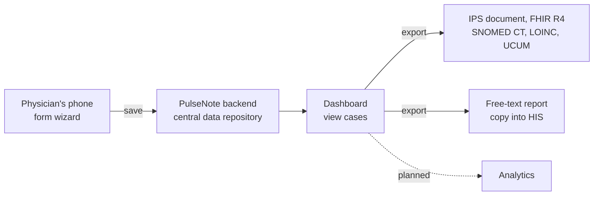

# PulseNote

Structured, mobile-first documentation forms for physicians in the emergency department (ED).

PulseNote lets ED physicians record history and physical examination at the bedside on their phone. Data is stored in a central repository. In a separate dashboard it can be reviewed and exported as an **HL7 FHIR R4 International Patient Summary (IPS)** with standard terminologies, or turned into **free-text reports** for import into the hospital information system (HIS).

> **Status:** Early planning. A local-only prototype (formerly *CaseFlow*) is live at [caseflow.christophriepe.com](https://caseflow.christophriepe.com). It stores all data in the browser and has no backend yet.

---

## Workflow

1. **At the bedside:** The physician opens a PulseNote form on their phone and picks the template that fits the patient (e.g. internal medicine, surgery, respiratory).
2. **Documentation:** They work through the three form steps: patient → history → examination.
3. **Save:** On save, the data goes to the central PulseNote backend and is stored there. The phone's part ends here.
4. **Review & export in the dashboard (any time):**
   - **View:** open and review saved cases.
   - **Free text:** generate a structured report and copy it into the HIS.
   - **FHIR:** export an IPS document (FHIR R4), coded with SNOMED CT, LOINC and UCUM, plus ICD-10-GM as an additional coding for diagnoses.
5. **Analytics (planned):** statistics across all cases in the dashboard.

---

## Features

### Form templates (phone)

Each template is a three-step wizard. After the last step the physician saves, and the data is sent to the backend. Nothing is viewed or exported on the phone.

| Step                     | Contents (example: General)                                                                                                                                                                                                                              |
| ------------------------ | -------------------------------------------------------------------------------------------------------------------------------------------------------------------------------------------------------------------------------------------------------- |
| **1. Patient**     | Sex, name, date of birth, height, weight, location (room, stretcher number)                                                                                                                                                                              |
| **2. History**     | Chief complaint, symptoms (chest pain, dyspnea, palpitations, syncope, …), allergies, past medical and surgical history, long-term medication, last meal, GP, referring physician, social history (care level, legal guardian, nursing home, insurance) |
| **3. Examination** | Vital signs (BP, HR, SpO₂, temperature, RR), lab findings, general and nutritional condition, heart, lungs, abdomen, extremities, other findings                                                                                                        |

Templates available in the prototype:

- **General**: internal medicine patients
- **Surgery**: surgical patients
- **Respiratory**: infection / respiratory clinic

Planned: orthopedics, neurology, pediatrics, and more.

### Dashboard

Saved cases are viewed and exported in the dashboard, a web app on top of the data repository, not on the physician's phone.

- **Case view**: browse and open saved cases
- **Free-text export**: generate the structured report and copy it into the HIS
- **IPS export**: a FHIR R4 document bundle following the International Patient Summary implementation guide (see [FHIR &amp; IPS](#fhir--ips))
- **Analytics (planned)**: e.g. case volumes, symptom distribution, documentation completeness

---

## Team & responsibilities

The team has four people. The four areas follow the course's team assessment criteria, so each graded criterion has exactly one owner. Owning an area means making its decisions and keeping it in shape, not working on it alone.

| # | Area                                     | Assessment criterion    | Owner       | Responsibilities                                                                                                                                                                                         |
| - | ---------------------------------------- | ----------------------- | ----------- | -------------------------------------------------------------------------------------------------------------------------------------------------------------------------------------------------------- |
| 1 | **Medical domain & use case**      | Use case and user focus | Christoph   | Clinical problem and user needs, clinical content of the forms (fields, answer options, templates), free-text report content and wording, test cases and sample patients, dashboard KPIs                  |
| 2 | **Backend & FHIR / IPS modelling** | FHIR / IPS modelling    | Jeremias??? | API, data model and storage, FHIR resources and IPS document bundle, validation against the IPS IG, free-text generation in code, deployment                                                             |
| 3 | **Terminologies**                  | Terminologies           | Heinrich??? | SNOMED CT, LOINC, UCUM, ICD-10-GM, ATC; ValueSets for every answer option; ConceptMaps; code bindings in the FHIR resources; IPS "absent/unknown" codes                                                  |
| 4 | **Frontend & prototype**           | Prototype and demo      | Chad???     | React web app, mobile UX and usability, form wizard, dashboard UI, demo build                                                                                                                            |

**Load balancing:**

- Area 2 carries the highest-weighted criterion plus the server itself. Data protection and hosting paperwork are therefore kept to a minimum for the course project.
- Areas 1 and 3 will likely have somewhat less work. Their owners help out in area 4 and especially in area 2.

### Shared contracts

Most problems happen where two areas meet, so these interfaces are agreed on together and changed only by agreement:

| Contract                                                                             | Between          | Format                                                      |
| ------------------------------------------------------------------------------------ | ---------------- | ----------------------------------------------------------- |
| **Form definition**: fields, types, answer options and their codes             | 1 ↔ 3 ↔ 4 ↔ 2 | Shared schema (e.g. JSON Schema or FHIR `Questionnaire`)  |
| **Terminology bindings**: which code and ValueSet goes into which FHIR element | 3 ↔ 2           | Mapping table in the repo                                   |
| **IPS mapping**: which form field goes into which IPS section and resource     | 2 ↔ 1 ↔ 3      | Mapping table in the repo (see [FHIR &amp; IPS](#fhir--ips)) |
| **API**: endpoints for saving, loading and exporting                           | 4 ↔ 2           | OpenAPI spec                                                |
| **Free-text report**: structure and wording of the HIS text                    | 1 ↔ 2           | Template with example output                                |

### Working agreements

- Pull requests that touch another area are **reviewed by that area's owner**.
- The **final presentation** is given by the whole team together. Each person mainly presents their own area.
- The **form definition comes first**: every area depends on it, so areas 1 and 3 define fields *with codes* together, before parallel work starts.
- Architecture decisions (e.g. backend option A vs. B) are made by the whole team and recorded as short decision records in `docs/decisions/`.

---

## Architecture

| Layer    | Technology                                                                               |
| -------- | ---------------------------------------------------------------------------------------- |
| Frontend | React (mobile-first web app)                                                             |
| Backend  | **To be decided** (see options below)                                              |
| Hosting  | **Cloud (EU, GDPR-compliant)** preferred; on-premise as an alternative (see below) |

### Backend options

#### Option A: Custom API (Node.js / TypeScript) + PostgreSQL

The backend stores form data in its own data model (e.g. relational tables plus JSONB). A mapping layer turns it into FHIR resources on export.

#### Option B: FHIR server as primary storage

Form data is mapped to FHIR resources on save and stored directly in a FHIR server (e.g. [HAPI FHIR](https://hapifhir.io/) on PostgreSQL). A thin API layer in front handles authentication, form logic and free-text generation.

|                                  | **A: Node/TS + PostgreSQL**                               | **B: FHIR server**                                           |
| -------------------------------- | --------------------------------------------------------------- | ------------------------------------------------------------------ |
| **FHIR export**            | ➖ Own mapping layer needed, must be kept in sync with profiles | ➕ Data is already FHIR; export is a simple bundle query           |
| **Profile validation**     | ➖ Needs an external validator (e.g. HAPI validator)            | ➕ Built-in validation against profiles                            |
| **Data model flexibility** | ➕ Free to model data the way the forms need; easy to iterate   | ➖ Every form change needs a FHIR mapping decision up front        |
| **Form versioning**        | ➕ Simple: store form version alongside the data                | ➖ Needs `Questionnaire` versioning or extensions                |
| **Dashboard / analytics**  | ➕ Plain SQL on familiar tables                                 | ➖ FHIR search isn't built for analytics; needs ETL or SQL-on-FHIR |
| **Free-text export**       | ➕ Generated straight from the internal model                   | ➖ Must be generated from FHIR resources                           |
| **Interoperability**       | ➖ Only through export                                          | ➕ Standard FHIR REST API out of the box                           |
| **Tech stack**             | ➕ One language (TypeScript) end to end                         | ➖ Adds a Java-based server to run and maintain                    |
| **Operational effort**     | ➕ Lightweight                                                  | ➖ Heavier (JVM, memory, upgrades)                                 |
| **Lock-in risk**           | ➖ Custom schema                                                | ➕ Standard data format                                            |

**Hybrid option:** Start with Option A and keep a raw `QuestionnaireResponse` per form. Add a FHIR server later as an export target or sync destination if interoperability needs grow.

### Hosting options

**Preferred: cloud hosting in the EU, GDPR-compliant.** On-premise in the hospital is the alternative.

|                                    | **Cloud (EU)**                                                                                                                                                                                                                     | **On-premise (hospital)**                                            |
| ---------------------------------- | ---------------------------------------------------------------------------------------------------------------------------------------------------------------------------------------------------------------------------------------- | -------------------------------------------------------------------------- |
| **Time to first deployment** | ➕ Fast; managed database, backups, TLS                                                                                                                                                                                                  | ➖ Depends on hospital IT processes and resources                          |
| **Access from phones**       | ➕ Reachable over the internet (with strong auth)                                                                                                                                                                                        | ➖ Needs hospital Wi-Fi, VPN or MDM-managed devices                        |
| **Approval**                 | ➖ Needs data protection officer approval, a data processing agreement (AVV), and possibly a cloud attestation (e.g. BSI C5); German hospital and professional secrecy rules (§ 203 StGB, state hospital laws) may restrict outsourcing | ➕ Patient data stays in the hospital network, so approval is often easier |
| **HIS integration**          | ➖ Needs a secure link into the hospital network                                                                                                                                                                                         | ➕ Close to the HIS; direct integration possible later                     |
| **Operations & updates**     | ➕ Central; one deployment for all users                                                                                                                                                                                                 | ➖ Per-site installation and updates                                       |
| **Scalability / multi-site** | ➕ Easy to serve several hospitals                                                                                                                                                                                                       | ➖ Every site runs its own instance                                        |
| **Costs**                    | ➖ Ongoing hosting costs                                                                                                                                                                                                                 | ➖ Hardware and IT staff time at the hospital                              |

---

## FHIR & IPS

The export follows the **HL7 FHIR International Patient Summary (IPS)** implementation guide (FHIR R4, [hl7.org/fhir/uv/ips](http://hl7.org/fhir/uv/ips)).

Each saved case becomes an **IPS document**: a `Bundle` of type `document`. Its first entry is a `Composition` with LOINC `60591-5` (*Patient summary Document*). After it come the resources that the Composition's sections reference.

### Form content → IPS sections

| Form content                                              | IPS section (LOINC)                      | Resource / profile                                  | Terminology                               |
| --------------------------------------------------------- | ---------------------------------------- | --------------------------------------------------- | ----------------------------------------- |
| Patient demographics                                      | – (`Composition.subject`)             | `Patient` (IPS)                                   | –                                        |
| Chief complaint, current symptoms                         | Problems (`11450-4`)                   | `Condition` (IPS)                                 | SNOMED CT                                 |
| Allergies                                                 | Allergies and intolerances (`48765-2`) | `AllergyIntolerance` (IPS)                        | SNOMED CT                                 |
| Long-term medication                                      | Medication summary (`10160-0`)         | `MedicationStatement` (IPS), `Medication` (IPS) | SNOMED CT, ATC                            |
| Past medical history                                      | History of past illness (`11348-0`)    | `Condition` (IPS)                                 | SNOMED CT, ICD-10-GM as additional coding |
| Past surgeries                                            | History of procedures (`47519-4`)      | `Procedure` (IPS)                                 | SNOMED CT                                 |
| Vital signs, height, weight                               | Vital signs (`8716-3`)                 | `Observation` (FHIR vital signs profiles)         | LOINC, UCUM                               |
| Lab findings                                              | Results (`30954-2`)                    | `Observation` (IPS results profiles)              | LOINC, SNOMED CT                          |
| Social history (care level, nursing home, legal guardian) | Social history (`29762-2`)             | `Observation`                                     | SNOMED CT / LOINC _(to be modelled)_    |

**Required sections:** The IPS requires *Problems*, *Allergies and intolerances* and *Medication summary*. They must be present even when the form has no entries. For that case the IPS defines explicit codes such as "no known allergies" or "no information about medications". The form's "No" answers map to these codes.

### Vital signs (LOINC + UCUM)

| Measurement                        | LOINC                    | UCUM unit  |
| ---------------------------------- | ------------------------ | ---------- |
| Blood pressure panel               | `85354-9`              | –         |
| ↳ Systolic                        | `8480-6`               | `mm[Hg]` |
| ↳ Diastolic                       | `8462-4`               | `mm[Hg]` |
| Heart rate                         | `8867-4`               | `/min`   |
| Respiratory rate                   | `9279-1`               | `/min`   |
| Oxygen saturation (pulse oximetry) | `2708-6` / `59408-5` | `%`      |
| Body temperature                   | `8310-5`               | `Cel`    |
| Body height                        | `8302-2`               | `cm`     |
| Body weight                        | `29463-7`              | `kg`     |

### Outside the IPS scope

The IPS is a *summary*, not ED encounter documentation. Several form fields have no matching IPS section:

- Physical examination findings (heart, lungs, abdomen, extremities, general condition)
- ED context: room, stretcher number, last meal, GP, referring physician, insurance

Options, still to be decided:

1. Add extra sections to the `Composition` (check what the IPS IG allows)
2. Export them as additional resources (`Encounter`, `Observation`) in a companion bundle next to the IPS document
3. Keep them only in the free-text report

### Terminologies

| Terminology         | Used for                                                                                                           |
| ------------------- | ------------------------------------------------------------------------------------------------------------------ |
| **SNOMED CT** | Problems, symptoms, findings, allergies, procedures, medication. Germany has a national license through the BfArM. |
| **LOINC**     | IPS section codes, vital signs, lab results                                                                        |
| **UCUM**      | All units of measure                                                                                               |
| **ICD-10-GM** | Additional coding for diagnoses (German context)                                                                   |
| **ATC**       | Medication classes                                                                                                 |

Every answer option in the forms is backed by a **ValueSet**, so the form, the FHIR export and the free-text report all use the same codes.

---

## Data protection & security

PulseNote processes health data, a special category under Art. 9 GDPR. Minimum requirements:

- Encryption in transit (TLS) and at rest
- Authentication and role-based access control for physicians
- Audit logging of access and changes
- Data processing agreement (AVV) with the hosting provider
- Defined retention and deletion periods
- No patient data in URLs, logs or analytics tools

---

## Roadmap

- [X] Local prototype with General, Surgery and Respiratory templates
- [ ] Decide backend architecture (Option A vs. B)
- [ ] Decide hosting and get data protection approval
- [ ] Authentication and user management
- [ ] Central backend with save and load
- [ ] Phone forms reduced to three steps, saving to the backend
- [ ] Dashboard with case view
- [ ] Free-text export in the dashboard
- [ ] IPS export (FHIR R4) in the dashboard, validated against the IPS implementation guide
- [ ] More specialty templates (orthopedics, neurology, pediatrics, …)
- [ ] Dashboard analytics

---

## Open questions

- **Authentication:** Hospital SSO (e.g. via Keycloak / OIDC), or separate PulseNote accounts?
- **Patient identification:** How are cases linked to the HIS (case number, patient ID, barcode scan)?
- **Offline support:** Do forms need to work without a connection (e.g. poor reception in the ED) and sync later?
- **Multi-tenancy:** One instance per hospital, or one shared instance for several hospitals?
- **Editing & sign-off:** Can saved forms be edited later? Is there a final sign-off or a version history?
- **Language:** German only, or multilingual forms?
- **Data outside the IPS:** Where do exam findings and ED-specific details go in the FHIR export (see [Outside the IPS scope](#outside-the-ips-scope))?

---

## Getting started

_Not yet available. Setup instructions will follow once the project skeleton is in place._

## License

_To be decided._
