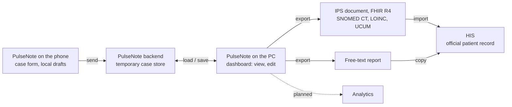

# PulseNote

Structured, mobile-first documentation forms for physicians in the emergency department (ED).

PulseNote lets ED physicians record history and physical examination at the bedside on their phone. Data is stored temporarily in a central repository. On a desktop PC, the same web app offers a dashboard where cases can be reviewed, edited and transferred into the hospital information system (HIS), either as an **HL7 FHIR R4 International Patient Summary (IPS)** with standard terminologies or as a **free-text report**.

**The HIS remains the patient record.** PulseNote is an input tool: it holds a case only until it has been transferred to the HIS.

> **Status:** Early planning. A local-only prototype (formerly *CaseFlow*) is live at [caseflow.christophriepe.com](https://caseflow.christophriepe.com). It stores all data in the browser and has no backend yet.

> **This repository** is the shared monorepo for the whole project: frontend (`apps/web`), backend (`apps/api`) and shared packages (`packages/`). See [Repository structure](#repository-structure).

---

## Workflow

1. **At the bedside:** The physician signs in to PulseNote on their phone, opens a new case and picks the template that fits the patient (e.g. internal medicine, surgery, respiratory).
2. **Documentation:** They work through the three form steps: patient → history → examination. Every input is saved locally on the phone right away, so nothing is lost if the app is closed or the connection drops.
3. **Send:** When the case is complete, the physician sends it to the central PulseNote backend. Without a connection, it stays on the phone as an unsent draft until it can be sent.
4. **Review, edit & export on the PC (any time):** The physician signs in to the same web app on a desktop PC with the same credentials and opens the dashboard.
   - **View:** open and review saved cases.
   - **Edit:** complete or correct a case.
   - **Free text:** generate a structured report and copy it into the HIS.
   - **FHIR:** export an IPS document (FHIR R4) for import into the HIS, coded with SNOMED CT, LOINC and UCUM, plus ICD-10-GM as an additional coding for diagnoses.
5. **Hand-over to the HIS:** Once the case is in the HIS, the HIS entry is the official record. PulseNote deletes the case after a defined retention period.
6. **Analytics (planned):** statistics across cases in the dashboard, based on pseudonymized or aggregated data.



---

## Features

PulseNote is **one web app with one login**, built as a Progressive Web App (PWA) that can be installed on the phone's home screen and works offline. It has two views:

- the **case form**, optimized for phones
- the **dashboard**, optimized for desktop monitors

Both views use the same form components and field definitions. A case entered on the phone looks and validates the same way when it is edited on the PC.

### Case form (optimized for phones)

Each template is a three-step wizard. After the last step the physician sends the case to the backend. On the PC, the same fields are shown on a single page for editing.

**Case list on the phone:** The phone shows the physician's own cases of the current shift in two groups:

- **Drafts:** cases stored locally on the phone that have not been sent yet, clearly marked as "not sent"
- **Sent:** cases already on the server. They are loaded fresh from the server each time and are not stored on the phone, so they are only visible with a connection.

Older cases are available in the dashboard on the PC.

| Step                     | Contents (example: General)                                                                                                                                                                                                                              |
| ------------------------ | -------------------------------------------------------------------------------------------------------------------------------------------------------------------------------------------------------------------------------------------------------- |
| **1. Patient**     | Sex, name, date of birth, height, weight, location (room, stretcher number)                                                                                                                                                                              |
| **2. History**     | Chief complaint, symptoms (chest pain, dyspnea, palpitations, syncope, …), allergies, past medical and surgical history, long-term medication, last meal, GP, referring physician, social history (care level, legal guardian, nursing home, insurance) |
| **3. Examination** | Vital signs (BP, HR, SpO₂, temperature, RR), lab findings, general and nutritional condition, heart, lungs, abdomen, extremities, other findings                                                                                                        |

Templates available in the prototype:

- **General**: internal medicine patients
- **Surgery**: surgical patients
- **Respiratory**: infection / respiratory clinic

Planned: orthopedics, neurology, pediatrics, and more.

### Offline use & local drafts

Connectivity in the ED is unreliable, and losing ten minutes of history taking is not acceptable. The case form therefore works fully offline:

| What                  | Offline | How                                                                                     |
| --------------------- | ------- | --------------------------------------------------------------------------------------- |
| Open the app          | ✅      | A service worker caches the app (e.g. via `vite-plugin-pwa`). The first start needs a connection. |
| Fill in a case        | ✅      | Form definitions ship with the app                                                       |
| Save drafts           | ✅      | Autosave after every input to IndexedDB in the browser                                   |
| Send a case           | ❌      | Needs a connection; the draft stays on the phone until then                              |
| See sent cases        | ❌      | Loaded from the server only, by design                                                   |

**Things to watch:**

- **Session:** Signing in again is impossible offline. The session lasts a full shift, and drafts stay editable even if the session has expired. Signing in again is only needed to send.
- **App updates:** New versions arrive on the next start with a connection. The backend must therefore accept cases built with older form versions.
- **No duplicates:** Each case gets its ID on the phone, so sending it again after a dropped connection does not create a second copy.
- **iOS:** Safari and the home-screen app have separate storage. Physicians always use the installed home-screen app.
- **Native app:** Not needed. If native features are needed later (secure system storage, wristband barcode scanning, distribution via the hospital's device management), the same React app can be wrapped with [Capacitor](https://capacitorjs.com/).

### Dashboard (optimized for desktop)

Saved cases are reviewed, edited and exported in the dashboard. It works on a phone, but it is designed for monitors.

- **Case view**: browse and open saved cases
- **Editing**: complete or correct a case using the same fields as the case form
- **Free-text export**: generate the structured report and copy it into the HIS
- **IPS export**: a FHIR R4 document bundle following the International Patient Summary implementation guide (see [FHIR &amp; IPS](#fhir--ips))
- **Analytics (planned)**: e.g. case volumes, symptom distribution, documentation completeness

---

## Team & responsibilities

The team has four people. The four areas follow the course's team assessment criteria, so each graded criterion has exactly one owner. Owning an area means making its decisions and keeping it in shape, not working on it alone.

| # | Area                                     | Assessment criterion    | Owner       | Responsibilities                                                                                                                                                                         |
| - | ---------------------------------------- | ----------------------- | ----------- | ---------------------------------------------------------------------------------------------------------------------------------------------------------------------------------------- |
| 1 | **Medical domain & use case**      | Use case and user focus | Christoph   | Clinical problem and user needs, clinical content of the forms (fields, answer options, templates), free-text report content and wording, test cases and sample patients, dashboard KPIs |
| 2 | **Backend & FHIR / IPS modelling** | FHIR / IPS modelling    | Jeremias??? | API, data model and storage, FHIR resources and IPS document bundle, validation against the IPS IG, free-text generation in code, deployment                                             |
| 3 | **Terminologies**                  | Terminologies           | Heinrich??? | SNOMED CT, LOINC, UCUM, ICD-10-GM, ATC; ValueSets for every answer option; ConceptMaps; code bindings in the FHIR resources; IPS "absent/unknown" codes                                  |
| 4 | **Frontend & prototype**           | Prototype and demo      | Chad???     | React web app (case form and dashboard), login UI, mobile and desktop UX, demo build                                                                                                     |

**Load balancing:**

- Area 2 carries the highest-weighted criterion plus the server itself. Data protection and hosting paperwork are therefore kept to a minimum for the course project.
- Areas 1 and 3 will likely have somewhat less work. Their owners help out in area 4 and especially in area 2.

### Shared contracts

Most problems happen where two areas meet, so these interfaces are agreed on together and changed only by agreement:

| Contract                                                                             | Between          | Format                                                      |
| ------------------------------------------------------------------------------------ | ---------------- | ----------------------------------------------------------- |
| **Form definition**: fields, types, answer options and their codes             | 1 ↔ 3 ↔ 4 ↔ 2 | Shared schema (e.g. JSON Schema or FHIR `Questionnaire`)  |
| **Terminology bindings**: which code and ValueSet goes into which FHIR element | 3 ↔ 2           | Mapping table in the repo                                   |
| **IPS mapping**: which form field goes into which IPS section and resource     | 2 ↔ 1 ↔ 3      | Mapping table in the repo (see [FHIR &amp; IPS](#fhir--ips)) |
| **API**: endpoints for saving, loading and exporting                           | 4 ↔ 2           | OpenAPI spec                                                |
| **Free-text report**: structure and wording of the HIS text                    | 1 ↔ 2           | Template with example output                                |

### Working agreements

- Pull requests that touch another area are **reviewed by that area's owner**. [`.github/CODEOWNERS`](.github/CODEOWNERS) maps each folder to its owners, so GitHub requests the right reviewers automatically.
- The **final presentation** is given by the whole team together. Each person mainly presents their own area.
- The **form definition comes first**: every area depends on it, so areas 1 and 3 define fields *with codes* together, before parallel work starts.
- Architecture decisions (e.g. backend option A vs. B) are made by the whole team and recorded as short decision records in `docs/decisions/`.

---

## Architecture

| Layer    | Technology                                                                               |
| -------- | ---------------------------------------------------------------------------------------- |
| Frontend | One React web app as an offline-capable PWA: case form (mobile-first) and dashboard (desktop), shared login |
| Backend  | **To be decided** (see options below)                                              |
| Hosting  | **On-premise in the hospital intranet** for production; cloud only for development and demo with synthetic data (see below) |

### Repository structure

The project is a single repository (monorepo). Everything that runs and is deployed lives in `apps/`. Libraries shared by several apps live in `packages/`.

```
pulsenote/
├── apps/
│   ├── web/                    # React web app: case form + dashboard (area 4)
│   │   └── src/
│   │       ├── features/
│   │       │   ├── case-form/  # three-step wizard (phone) / single page (PC), local drafts
│   │       │   └── dashboard/  # case list, editing, export, analytics
│   │       ├── auth/           # shared login
│   │       └── components/     # shared UI building blocks
│   └── api/                    # backend (area 2)
│       ├── src/
│       │   ├── routes/         # endpoints: save, load, export cases
│       │   ├── auth/           # authentication, roles
│       │   ├── db/             # database access
│       │   └── export/         # IPS bundle and free-text generation
│       └── migrations/         # database schema
├── packages/
│   ├── form-definitions/       # fields, answer options and codes (area 1, codes with area 3)
│   ├── terminology/            # ValueSets, ConceptMaps (area 3)
│   └── fhir-mapping/           # form data → IPS resources (area 2)
├── docs/
│   └── decisions/              # architecture decision records
└── README.md
```

The database is not part of the repository. Locally it will run as a Docker container, in production on the hospital's servers. Only its schema (`apps/api/migrations/`) lives here.

### Backend options

#### Option A: Custom API (Node.js / TypeScript) + PostgreSQL

The backend stores form data in its own data model (e.g. relational tables plus JSONB). A mapping layer turns it into FHIR resources on export.

#### Option B: FHIR server as primary storage

Form data is mapped to FHIR resources on save and stored directly in a FHIR server (e.g. [HAPI FHIR](https://hapifhir.io/) on PostgreSQL). A thin API layer in front handles authentication, form logic and free-text generation.

|                                  | **A: Node/TS + PostgreSQL**                               | **B: FHIR server**                                           |
| -------------------------------- | --------------------------------------------------------------- | ------------------------------------------------------------------ |
| **FHIR export**            | ➖ Own mapping layer needed, must be kept in sync with profiles | ➕ Data is already FHIR; export is a simple bundle query           |
| **Profile validation**     | ➖ Needs an external validator (e.g. HAPI validator)            | ➕ Built-in validation against profiles                            |
| **Data model flexibility** | ➕ Free to model data the way the forms need; easy to iterate   | ➖ Every form change needs a FHIR mapping decision up front        |
| **Form versioning**        | ➕ Simple: store form version alongside the data                | ➖ Needs `Questionnaire` versioning or extensions                |
| **Dashboard / analytics**  | ➕ Plain SQL on familiar tables                                 | ➖ FHIR search isn't built for analytics; needs ETL or SQL-on-FHIR |
| **Free-text export**       | ➕ Generated straight from the internal model                   | ➖ Must be generated from FHIR resources                           |
| **Interoperability**       | ➖ Only through export                                          | ➕ Standard FHIR REST API out of the box                           |
| **Tech stack**             | ➕ One language (TypeScript) end to end                         | ➖ Adds a Java-based server to run and maintain                    |
| **Operational effort**     | ➕ Lightweight                                                  | ➖ Heavier (JVM, memory, upgrades)                                 |
| **Lock-in risk**           | ➖ Custom schema                                                | ➕ Standard data format                                            |

**Hybrid option:** Start with Option A and keep a raw `QuestionnaireResponse` per form. Add a FHIR server later as an export target or sync destination if interoperability needs grow.

### Hosting options

**Production: on-premise in the hospital intranet.** Patient data never leaves the hospital network.

**Development and demo: cloud.** Allowed only with synthetic patients, never with real patient data.

|                              | **On-premise (hospital intranet)**                                                  | **Cloud (EU)**                                                                                                                                                                                                                     |
| ---------------------------- | ----------------------------------------------------------------------------------- | ---------------------------------------------------------------------------------------------------------------------------------------------------------------------------------------------------------------------------------- |
| **Approval**                 | ➕ Patient data stays in the hospital network, so approval is much easier           | ➖ Needs data protection officer approval, a data processing agreement (AVV), and possibly a cloud attestation (e.g. BSI C5); German hospital and professional secrecy rules (§ 203 StGB, state hospital laws) may restrict outsourcing |
| **HIS integration**          | ➕ Close to the HIS; direct integration possible later                              | ➖ Needs a secure link into the hospital network                                                                                                                                                                                   |
| **Login**                    | ➕ Can use existing hospital accounts                                               | ➖ Needs a connection to the hospital's directory, or separate accounts                                                                                                                                                            |
| **Access from phones**       | ➖ Needs hospital Wi-Fi and hospital-managed devices                                 | ➕ Reachable over the internet (with strong auth)                                                                                                                                                                                  |
| **Time to first deployment** | ➖ Depends on hospital IT processes and resources                                    | ➕ Fast; managed database, backups, TLS                                                                                                                                                                                            |
| **Operations & updates**     | ➖ Per-site installation and updates                                                 | ➕ Central; one deployment for all users                                                                                                                                                                                           |
| **Scalability / multi-site** | ➖ Every site runs its own instance                                                   | ➕ Easy to serve several hospitals                                                                                                                                                                                                 |
| **Costs**                    | ➖ Hardware and IT staff time at the hospital                                        | ➖ Ongoing hosting costs                                                                                                                                                                                                           |

**Conditions for on-premise operation:**

- Run officially by the hospital IT, not as a privately operated server in the hospital network
- Listed in the hospital's record of processing activities, with a data protection impact assessment (DPIA)
- Used on hospital-managed devices (MDM) with device encryption and screen lock; only unsent drafts are stored on the phone, temporarily

---

## FHIR & IPS

The export follows the **HL7 FHIR International Patient Summary (IPS)** implementation guide (FHIR R4, [hl7.org/fhir/uv/ips](http://hl7.org/fhir/uv/ips)).

Each saved case becomes an **IPS document**: a `Bundle` of type `document`. Its first entry is a `Composition` with LOINC `60591-5` (*Patient summary Document*). After it come the resources that the Composition's sections reference.

### Form content → IPS sections

| Form content                                              | IPS section (LOINC)                      | Resource / profile                                  | Terminology                               |
| --------------------------------------------------------- | ---------------------------------------- | --------------------------------------------------- | ----------------------------------------- |
| Patient demographics                                      | – (`Composition.subject`)             | `Patient` (IPS)                                   | –                                        |
| Chief complaint, current symptoms                         | Problems (`11450-4`)                   | `Condition` (IPS)                                 | SNOMED CT                                 |
| Allergies                                                 | Allergies and intolerances (`48765-2`) | `AllergyIntolerance` (IPS)                        | SNOMED CT                                 |
| Long-term medication                                      | Medication summary (`10160-0`)         | `MedicationStatement` (IPS), `Medication` (IPS) | SNOMED CT, ATC                            |
| Past medical history                                      | History of past illness (`11348-0`)    | `Condition` (IPS)                                 | SNOMED CT, ICD-10-GM as additional coding |
| Past surgeries                                            | History of procedures (`47519-4`)      | `Procedure` (IPS)                                 | SNOMED CT                                 |
| Vital signs, height, weight                               | Vital signs (`8716-3`)                 | `Observation` (FHIR vital signs profiles)         | LOINC, UCUM                               |
| Lab findings                                              | Results (`30954-2`)                    | `Observation` (IPS results profiles)              | LOINC, SNOMED CT                          |
| Social history (care level, nursing home, legal guardian) | Social history (`29762-2`)             | `Observation`                                     | SNOMED CT / LOINC _(to be modelled)_    |

**Required sections:** The IPS requires *Problems*, *Allergies and intolerances* and *Medication summary*. They must be present even when the form has no entries. For that case the IPS defines explicit codes such as "no known allergies" or "no information about medications". The form's "No" answers map to these codes.

### Vital signs (LOINC + UCUM)

| Measurement                        | LOINC                    | UCUM unit  |
| ---------------------------------- | ------------------------ | ---------- |
| Blood pressure panel               | `85354-9`              | –         |
| ↳ Systolic                        | `8480-6`               | `mm[Hg]` |
| ↳ Diastolic                       | `8462-4`               | `mm[Hg]` |
| Heart rate                         | `8867-4`               | `/min`   |
| Respiratory rate                   | `9279-1`               | `/min`   |
| Oxygen saturation (pulse oximetry) | `2708-6` / `59408-5` | `%`      |
| Body temperature                   | `8310-5`               | `Cel`    |
| Body height                        | `8302-2`               | `cm`     |
| Body weight                        | `29463-7`              | `kg`     |

### Outside the IPS scope

The IPS is a *summary*, not ED encounter documentation. Several form fields have no matching IPS section:

- Physical examination findings (heart, lungs, abdomen, extremities, general condition)
- ED context: room, stretcher number, last meal, GP, referring physician, insurance

Options, still to be decided:

1. Add extra sections to the `Composition` (check what the IPS IG allows)
2. Export them as additional resources (`Encounter`, `Observation`) in a companion bundle next to the IPS document
3. Keep them only in the free-text report

### Terminologies

| Terminology         | Used for                                                                                                           |
| ------------------- | ------------------------------------------------------------------------------------------------------------------ |
| **SNOMED CT** | Problems, symptoms, findings, allergies, procedures, medication. Germany has a national license through the BfArM. |
| **LOINC**     | IPS section codes, vital signs, lab results                                                                        |
| **UCUM**      | All units of measure                                                                                               |
| **ICD-10-GM** | Additional coding for diagnoses (German context)                                                                   |
| **ATC**       | Medication classes                                                                                                 |

Every answer option in the forms is backed by a **ValueSet**, so the form, the FHIR export and the free-text report all use the same codes.

---

## Data protection & security

PulseNote processes health data, a special category under Art. 9 GDPR. The legal basis is treatment by the treating physicians (Art. 9(2)(h) GDPR together with state hospital law).

**Principles:**

- **The HIS remains the patient record.** PulseNote is a temporary store. A case is deleted after a defined retention period once it has been transferred to the HIS.
- **On-premise operation** by the hospital IT (see [Hosting options](#hosting-options))
- **Only unsent drafts on the device, temporarily** (see [Offline use & local drafts](#offline-use--local-drafts)):
  - A draft is deleted from the phone as soon as the server confirms receipt.
  - Unsent drafts expire after a fixed time (e.g. 12–24 hours, about one shift); the app warns before that.
  - Drafts are tied to the signed-in user and deleted on sign-out. Another person on the same device never sees them.
  - Sent cases are loaded from the server and never cached on the phone.
  - Most of the protection comes from the hospital-managed device (encryption, screen lock). Extra encryption in the browser adds little, since the key would sit on the same device.
- **Analytics** only on pseudonymized or aggregated data, since the treatment basis does not cover statistics by itself
- **Course project:** synthetic patients only, never real patient data

**Technical requirements:**

- Login with hospital accounts and role-based access control
- Encryption in transit (TLS) and at rest
- Audit logging of access and changes
- No patient data in URLs or logs

---

## Roadmap

- [X] Local prototype with General, Surgery and Respiratory templates
- [ ] Decide backend architecture (Option A vs. B)
- [ ] Data protection concept for on-premise operation (DPIA, retention period)
- [ ] Authentication and user management
- [ ] Central backend with save and load
- [ ] Case form with three steps, sending to the backend
- [ ] Local drafts with autosave and offline use (PWA)
- [ ] Case list on the phone (drafts and sent cases)
- [ ] Dashboard with case view and editing
- [ ] Free-text export in the dashboard
- [ ] IPS export (FHIR R4) in the dashboard, validated against the IPS implementation guide
- [ ] More specialty templates (orthopedics, neurology, pediatrics, …)
- [ ] Dashboard analytics

---

## Open questions

- **Authentication:** How do we connect to the hospital accounts (Active Directory / LDAP, or OIDC, e.g. via Keycloak)?
- **Patient identification:** How are cases linked to the HIS (case number, patient ID, barcode scan)?
- **Retention period:** How long does a case stay in PulseNote after it has been transferred to the HIS?
- **Draft expiry:** Do unsent drafts expire after 12 or 24 hours?
- **Sign-off & history:** Saved cases can be edited on the PC. Is there a final sign-off after which a case is locked, and do we need a version history of edits?
- **Language:** German only, or multilingual forms?
- **Data outside the IPS:** Where do exam findings and ED-specific details go in the FHIR export (see [Outside the IPS scope](#outside-the-ips-scope))?

---

## Getting started

_Not yet available. The folder skeleton is in place (see [Repository structure](#repository-structure)); setup instructions will follow once the tech stack is decided._

## License

_To be decided._
